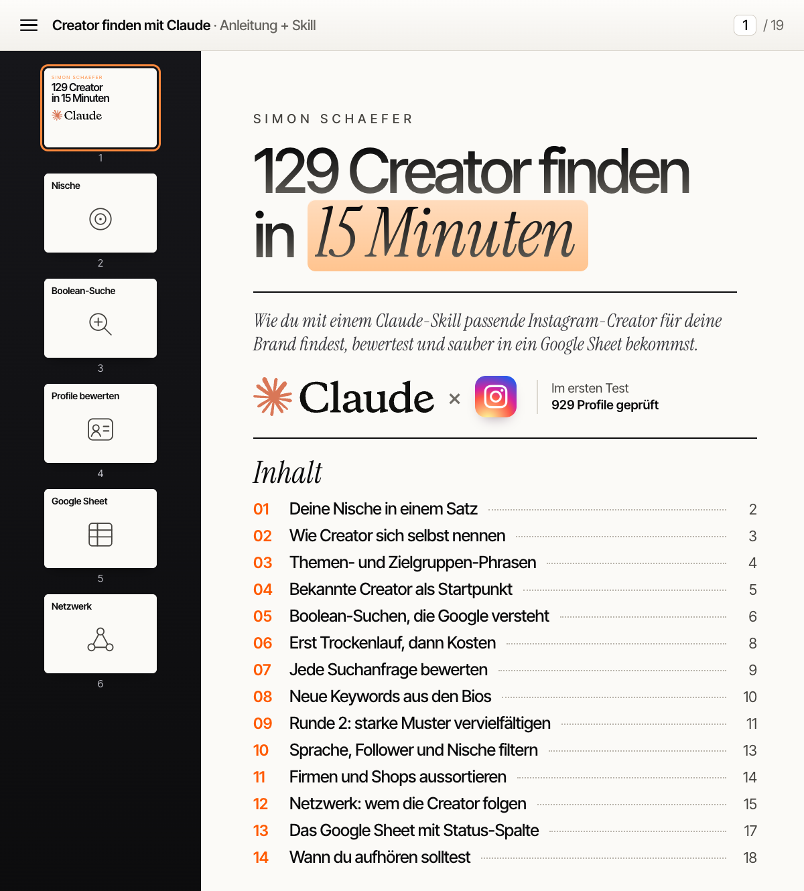

# Creator Finder

**Ein Claude-Code-Skill, der Instagram-Creator aus deiner Nische findet, jede Suche bewertet und dir eine fertige Liste fürs Google Sheet gibt.**



Im ersten Test (KI-Creator Deutschland): 109 Suchanfragen, 929 geprüfte Profile, **129 passende Creator** ab 1.000 Follower, deutschsprachig, Nische geprüft. Etwa 15 Minuten Laufzeit, 7,05 $ Apify-Kosten.

## Was der Skill macht

- **Keyword-Recherche:** sammelt die Wörter, mit denen sich Creator selbst beschreiben (Rollen, Themen, Zielgruppen)
- **Boolean-Suche über Google:** `site:instagram.com "KI für Coaches"` und Co., nach Regeln, die im Test gemessen wurden
- **Profile laden:** Follower, Bio, Kategorie, öffentliche E-Mail, Website, letzter Beitrag
- **Filtern mit Grund:** privat, Follower-Spanne, Organisation, Bio ohne Nischenwort, Bio nicht deutschsprachig
- **Jede Anfrage bewerten:** stark, behalten, raus, tot, gemessen an passenden Creatorn
- **Keyword-Ideen aus den Bios** für die nächste Runde, mit fertiger Anfrage
- **Netzwerk (optional):** wem die gefundenen Creator folgen, nur Kandidaten mit starkem Signal
- **Kostenschutz:** Trockenlauf mit Schätzung, Abbruch über deinem Budget, bezahlte Daten werden nie doppelt abgerufen
- **Ergebnis als CSV**, fertig zum Import in Google Sheets oder Excel, mit Status-Spalte

## Quick start

Du brauchst [Claude Code](https://docs.anthropic.com/claude-code) (Terminal oder Code-Tab der Claude-Desktop-App), Node 18 oder neuer und ein kostenloses [Apify-Konto](https://apify.com).

```bash
# 1. Skill installieren (für alle Projekte)
git clone https://github.com/simon-schaeferai/creator-finder ~/.claude/skills/creator-finder

# 2. Apify-Token in den Arbeitsordner legen (https://console.apify.com/settings/integrations)
echo "APIFY_TOKEN=apify_api_DEIN_TOKEN" >> .env
```

Claude Code neu starten und schreiben:

> Finde mir Instagram-Creator für Laufcoaches aus Deutschland, die Content für Hobbyläufer machen. Ab 1.000 Follower, Budget 2 $.

Claude fragt nach, was fehlt, zeigt dir die Suchanfragen und die Kosten und startet erst nach deinem Go. Die Ergebnisse liegen danach unter `output/creator-finder/<name>/`.

Ausführlich: [SETUP.md](SETUP.md). Das Werkzeug geht auch ohne Claude: `node scripts/creator-finder.mjs --help`.

## Was es kostet

Apify rechnet pro Ergebnis ab. Der Free-Plan enthält 5 $ Guthaben pro Monat (Stand 30.10.2026).

| Was | Im Test |
|---|---|
| Google-Runde mit 49 Anfragen | 1,27 $ · 52 passende Creator |
| Netzwerk-Runde mit 10 Startpunkten | 1,07 $ · 25 passende Creator |
| Rund 100 passende Creator | etwa 5 $ |

Gemessen im Bronze-Plan; im Free-Plan sind die Preise je Ergebnis etwas höher. Die echten Kosten stehen nach jedem Lauf in `info.csv`.

## Ergebnis

| Datei | Inhalt |
|---|---|
| `creator.csv` | passende Creator nach Followern, mit Status-Spalte (offen · passt · kontaktiert · raus) |
| `aussortiert.csv` | alle anderen Profile, mit Grund |
| `suchanfragen.csv` | jede Anfrage mit Treffern, passenden Creatorn und Urteil |
| `keyword-ideen.csv` | neue Wortgruppen aus den Bios, mit fertiger Anfrage |
| `info.csv` | Filter, Zahlen, echte Kosten |

## Grenzen

Was der Skill nicht tut:

- **Nur Instagram.** LinkedIn lieferte im Test keine brauchbaren Creator-Listen, TikTok und YouTube sind nicht eingebaut.
- **Sprachfilter nur für Deutsch.** Andere Sprachen gehen ohne `sprache_filter`, dann prüft nur die Nische.
- **Wortfilter, kein Urteil.** Wer die Nische nicht in der Bio nennt oder in Zierschrift schreibt, landet in `aussortiert.csv`. Eine Stichprobe gehört immer dazu.
- **Nur was Google kennt.** Neue oder sehr kleine Konten fehlen, das Netzwerk gleicht das teilweise aus.
- **Kein automatisches Google Sheet.** Du importierst die CSV mit zwei Klicks (Anleitung in SKILL.md).
- **Keine Kontaktdaten, die nicht öffentlich sind.** E-Mails stehen nur da, wo Creator sie selbst angeben (im Test 11 von 129). Schreib einzeln und persönlich an und beachte die DSGVO.

## Lizenz

MIT, siehe [LICENSE](LICENSE). Von [Simon Schaefer](https://www.simonschaefer.ai).
